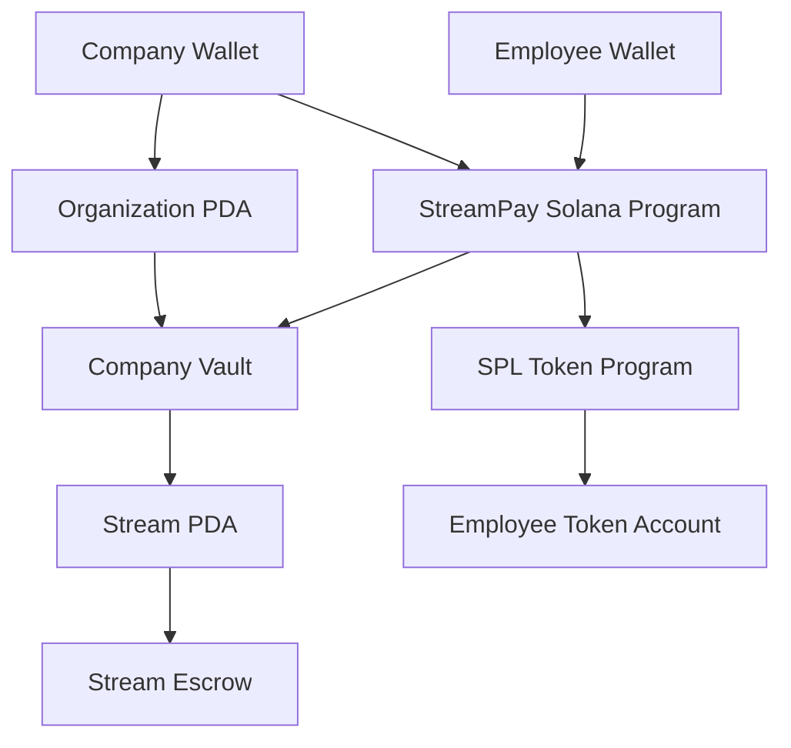
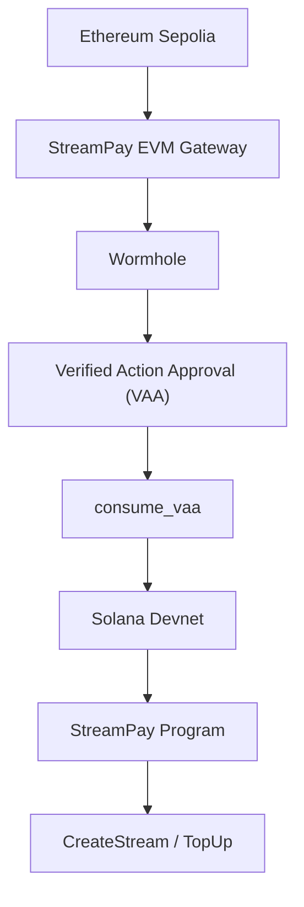
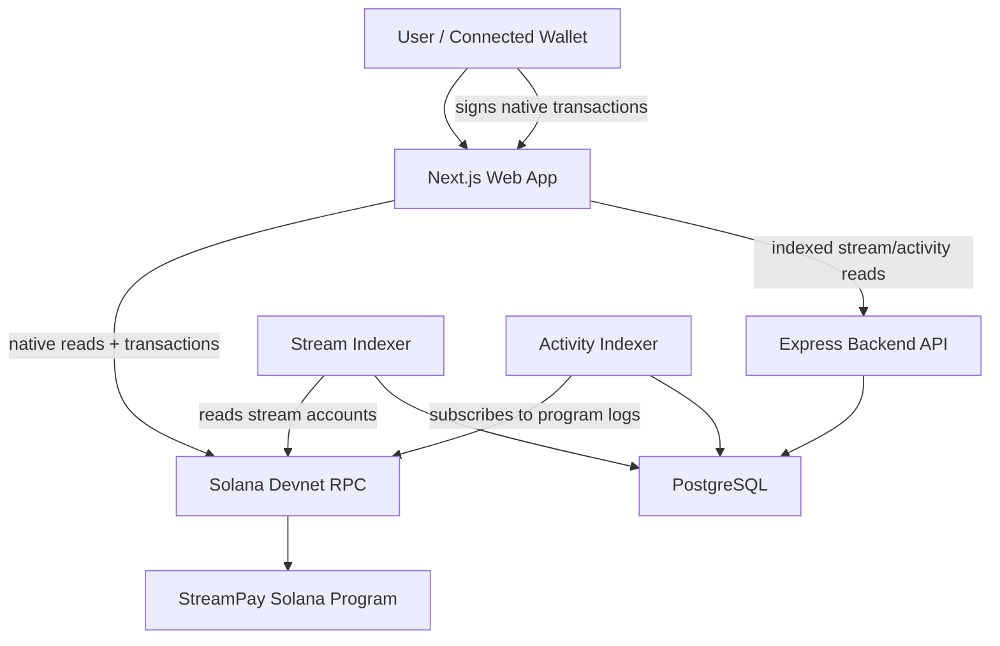
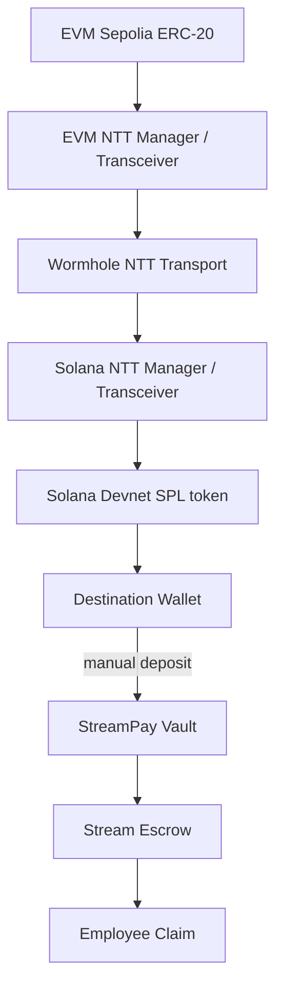
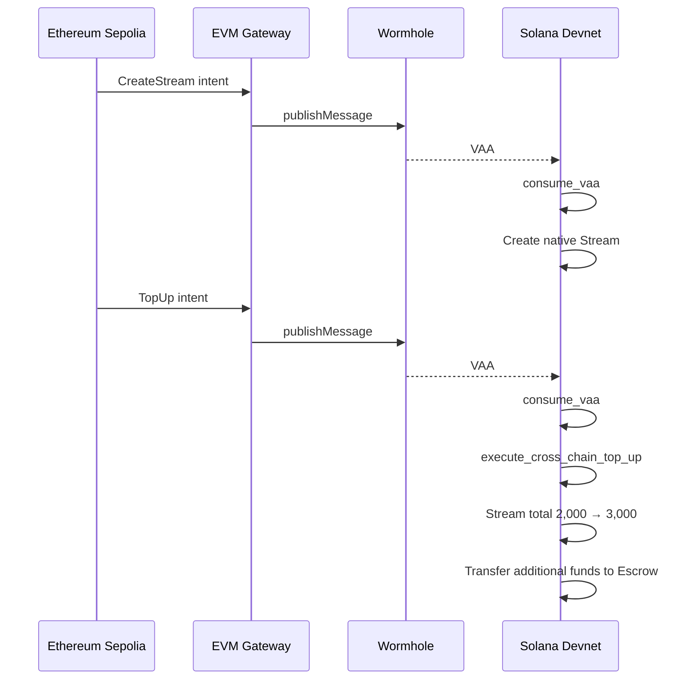
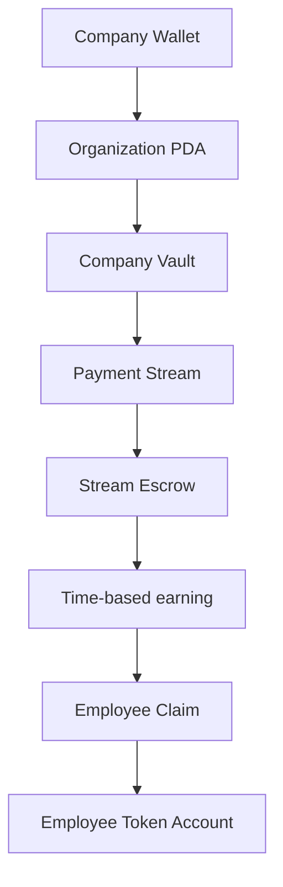
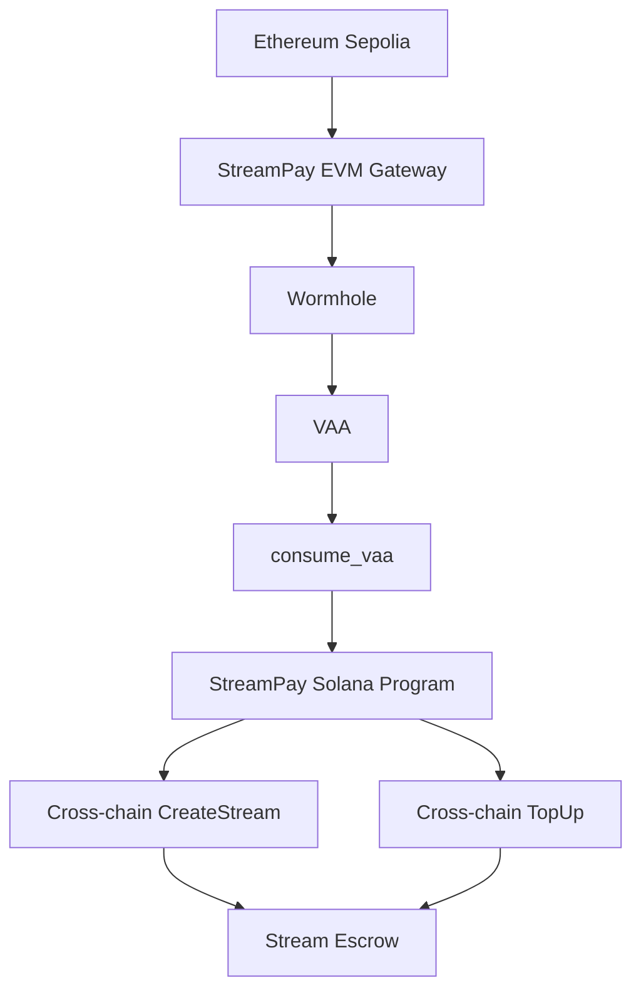
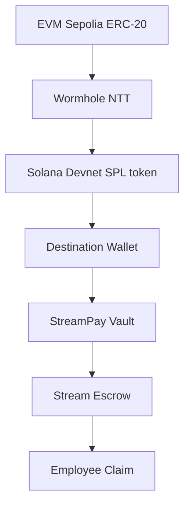

# StreamPay Solana

> **Trustless Cross-Chain Asset Streaming & Payroll Protocol**

StreamPay is a **Solana-first payroll protocol** that combines time-based payment streams with an EVM/Wormhole cross-chain execution layer and Wormhole NTT asset transfer.

---

## Navigation

- [Current Status]\(#current-status)

- [What StreamPay Does]\(#what-streampay-does)

- [Architecture]\(#architecture)

- [Core Solana Concepts]\(#core-solana-concepts)

- [Milestones]\(#milestones)

- [M0 — Environment]\(#m0--environment--fundamentals)

- [M1 — Protocol Configuration]\(#m1--protocol-configuration)

- [M2 — Token Vault]\(#m2--token-vault--deposits)

- [M3 — Organization]\(#m3--organization--company-vault)

- [M4 — Payment Stream]\(#m4--payment-stream)

- [M5 — Stream Lifecycle]\(#m5--cancel--top-up--stream-lifecycle)

- [M6 — Security]\(#m6--security--comprehensive-tests)

- [M7 — Frontend]\(#m7--frontend)

- [M8 — Backend / Indexer]\(#m8--backend--indexer)

- [M9 — EVM Gateway]\(#m9--evm-gateway)

- [M10 — Wormhole Messaging]\(#m10--cross-chain-messaging)

- [M11 — Cross-Chain Assets]\(#m11--cross-chain-assets)

- [M12 — Devnet + Documentation]\(#m12--devnet--documentation--portfolio)

- [Verified Test Evidence]\(#verified-test-evidence)

- [Public Deployment Identifiers]\(#public-deployment-identifiers)

- [Security Notes]\(#security-notes)

- [Final Project Picture]\(#final-project-picture)

---

# Current Status

## Milestone dashboard

| Milestone | Area | Current status |
|---|---|---|
| **M0** | Environment + Solana fundamentals | ✅ Complete |
| **M1** | Protocol configuration | ✅ Complete |
| **M2** | Token vault + deposits | ✅ Complete |
| **M3** | Organization + company vault | ✅ Complete |
| **M4** | Payment stream + employee claim | ✅ Complete |
| **M5** | Cancel / Top-up / stream lifecycle | ✅ Complete |
| **M6** | Security + comprehensive tests | ✅ Complete |
| **M7** | Frontend | ✅ Complete |
| **M8** | Backend / indexer | ✅ Complete |
| **M9** | EVM gateway | ✅ Complete |
| **M10** | Cross-chain messaging | ✅ Complete |
| **M11** | Cross-chain assets / NTT | ✅ Complete |
| **M12** | Devnet + documentation + portfolio | 🟡 In progress |

### Important status clarification

**M6 is complete.** The dedicated cross-chain security suite contains 19 tests and the native security suite contains 13 tests. The recorded complete regression is **41 passed / 0 failed**.

**M11 is complete.** A real EVM Sepolia → Solana Devnet asset transfer was demonstrated using Wormhole NTT. The destination asset then entered the StreamPay flow through a **manual vault deposit**.

**M11 does not currently prove an automated atomic `NTT receive → StreamPay Vault` relayer transaction.**

**M12 is in progress.** The technical prototype is now being packaged into reproducible documentation, architecture diagrams, demo instructions, evidence, and portfolio material.

---
# What StreamPay Does

StreamPay turns a fixed payroll amount into a **time-based payment stream**.

Example:

```text

Company

   ↓

funds payroll

   ↓

Company Vault

   ↓

creates Stream

   ↓

Stream Escrow

   ↓

time passes

   ↓

earned amount increases

   ↓

Employee claims earned amount

   ↓

Employee Token Account

```

For a `3,000 USDC` stream over `30 days`:

```text

Day 1   → a small amount is earned

Day 15  → roughly half is earned

Day 30  → the full amount is earned

```

The **Solana program is the source of truth** for protocol state, authorization, stream state, accounting, and claim calculations.

---

# Architecture

## 1. Native Solana architecture



The main relationship is:

```text

Company

   ↓

Organization

   ↓

Company Vault

   ↓

Create Stream

   ↓

Stream Escrow

   ↓

Time-based earning

   ↓

Employee Claim

```

## 2. Cross-chain architecture



The verified direction is:

```text

Ethereum Sepolia

      ↓

EVM Gateway

      ↓

Wormhole

      ↓

VAA

      ↓

Guardian signature verification

      ↓

consume_vaa

      ↓

StreamPay Solana Program

      ↓

Cross-chain action

```

## 3. Application / indexing architecture

The application has two distinct data paths:

1. **Native protocol interaction:** the Next.js application reads Solana state and submits native StreamPay transactions through the connected wallet.
2. **Indexed read path:** the Next.js application requests indexed streams and activity from the Express backend, which reads PostgreSQL populated by the stream and activity indexers.



**Source-of-truth rule:** PostgreSQL is an index/query layer. The Solana program remains authoritative for protocol state, authorization, stream accounting, and claims.

## 4. Cross-chain asset plane — NTT



The demonstrated M11 asset path is **NTT transfer → destination wallet → manual StreamPay Vault deposit**. The prototype does not claim an automated atomic NTT-receive-to-vault relayer.

---

# Core Solana Concepts

| Concept | Meaning in StreamPay |

|---|---|

| **Program** | On-chain Rust code containing StreamPay rules |

| **Account** | On-chain data/state |

| **Instruction** | One action exposed by the program |

| **Transaction** | Request containing one or more instructions |

| **Wallet** | Identity used to sign transactions |

| **Signer** | Account that must approve an action |

| **PDA** | Deterministic program-derived address |

| **CPI** | Program-to-program call on Solana |

| **Mint** | Defines a token |

| **Token Account** | Stores a token balance |

| **Vault** | Company funding token account |

| **Stream** | Time-based payment agreement |

| **Escrow** | Token account holding stream-reserved funds |

| **VAA** | Wormhole-attested cross-chain message |

---

# Program Instruction Inventory

## Native protocol

```text

initialize_protocol

create_organization

initialize_vault

deposit

create_stream

claim

```

## Cross-chain execution

```text

execute_cross_chain_create_stream

execute_cross_chain_top_up

```

## VAA processing

```text

consume_vaa

```

## Native lifecycle operations

```text

cancel_stream

top_up_stream

```

---

# Milestones

## M0 — Environment & Fundamentals

**Status: ✅ Complete**

### Goal

Prepare the development environment and understand the Solana concepts needed to build StreamPay.

### Toolchain

```text

Rust        1.98.1

Cargo       1.98.1

Solana CLI  4.1.2

Anchor CLI  1.2.0

AVM         1.2.0

Surfpool    1.6.0

```

### Result

```text

Rust + Anchor + Solana tooling

          ↓

Anchor project

          ↓

Build + test workflow

```

---

# M1 — Protocol Configuration

**Status: ✅ Complete**

## Goal

Create the basic StreamPay protocol configuration.

## ProtocolConfig PDA

The configuration stores:

```text

authority

version

paused

bump

created_at

```

## PDA derivation

```text

Program ID

   \+

"protocol"

   ↓

ProtocolConfig PDA

```

## Verified

```text

✅ ProtocolConfig created

✅ Correct authority

✅ Version = 1

✅ paused = false

✅ Correct PDA bump

✅ Creation timestamp stored

```

---

# M2 — Token Vault + Deposits

**Status: ✅ Complete**

## Goal

Create company-specific token storage and allow the company to deposit tokens into it.

## Vault relationship

```text

Organization

    │

    ├── Vault Authority PDA

    │

    └── Vault Token Account

             │

             └── Token balance

```

## Vault PDA derivation

```text

"vault"

   \+

Organization PDA

   \+

Mint

   ↓

Company Vault PDA

```

## Deposit flow

```text

Company Wallet

      ↓

deposit

      ↓

StreamPay Program

      ↓

CPI

      ↓

Token Program

      ↓

Company Vault

```

## Validation

The deposit path validates the depositor, organization authority, token mint, destination vault, and amount.

```text

deposit(positive amount) → allowed

deposit(0)               → rejected

```

## Verified

```text

✅ Vault creation

✅ Correct Mint

✅ Correct Vault Authority PDA

✅ Initial balance = 0

✅ Token transfer works

✅ Company balance decreases correctly

✅ Vault balance increases correctly

✅ CPI transfer works

✅ Zero-value deposit rejected

```

---

# M3 — Organization + Company Vault

**Status: ✅ Complete**

## Goal

Represent the company using StreamPay and connect that company to its own vault.

## Organization PDA

Stores:

```text

authority

bump

created_at

```

## PDA derivation

```text

"organization"

       \+

Company Wallet

       ↓

Organization PDA

```

## Company relationship

```text

Company Wallet

      ↓

Organization PDA

      ↓

Company Vault

      ↓

Company Token Balance

```

## Authorization rule

A company wallet must be the authority of the organization it is using.

An unauthorized wallet must not be able to operate on another company's organization.

## Verified

```text

✅ Organization PDA created

✅ Correct authority

✅ Correct bump

✅ Created timestamp stored

✅ Company-specific vault created

✅ Correct mint

✅ Correct vault authority

✅ Unauthorized organization access rejected

```

## M3 test result

```text

Organization tests     = 2 passed

Company Vault test     = 1 passed

M3 = COMPLETE

```

---

# M4 — Payment Stream

**Status: ✅ Complete**

## Goal

Create the payment agreement, reserve the funds in escrow, calculate earnings over time, and allow an employee to claim earned tokens.

## Stream data

A stream records:

```text

organization

employee

mint

total_amount

start_time

end_time

claimed_amount

```

## Create-stream flow

```text

Company Vault

      ↓

create_stream

      ↓

Stream PDA

      ↓

Stream Escrow

      ↓

Reserved stream funds

```

## Earned amount model

```text

Before start  → 0

At start      → 0

During stream → proportional amount

At end        → full amount

After end     → full amount

```

## Claim flow

```text

Employee Wallet

      ↓

claim

      ↓

StreamPay calculates claimable amount

      ↓

CPI

      ↓

Token Program

      ↓

Employee Token Account

```

## Claim safety tests

```text

Claim at stream start

   ↓

❌ nothing is earned

Claim the same amount again

   ↓

❌ nothing new is claimable

```

## Verified claim example

```text

Employee received:

500,000,000 base units

Escrow retained:

500,000,000 base units

claimed_amount:

500,000,000 base units

```

## Completed regression suite

```text

claim.rs             1 passed

organization.rs      2 passed

protocol_config.rs   1 passed

stream.rs            2 passed

vault.rs             1 passed

TOTAL                7 passed

FAILURES             0

```

## M4 result

```text

M4.1 Stream Account            ✅

M4.2 Create Stream             ✅

M4.2 Escrow funding            ✅

M4.3 Earned amount calculation ✅

M4.4 Employee Claim            ✅

M4.5 Claim safety tests        ✅

M4 = COMPLETE

```

---

# M5 — Cancel / Top-Up / Stream Lifecycle

**Status: ✅ Complete**

## Goal

Manage an existing stream after creation.

The native M5 phase covers:

```text
cancel_stream
top_up_stream
remaining-balance handling
stream lifecycle edge cases
```

Native lifecycle protections and edge-case handling include:

- employee claim
- stream top-up
- stream cancellation
- double-cancellation protection
- claim restrictions after cancellation
- protection against top-up after a stream has started
- zero-amount validation
- overflow checks
- invalid time-range checks

Cross-chain TopUp was successfully exercised through:

```text
EVM Gateway
   ↓
Wormhole
   ↓
VAA
   ↓
consume_vaa
   ↓
execute_cross_chain_top_up
   ↓
Stream state / escrow updated
```

M5 is treated as complete based on the implemented native lifecycle and the verified regression evidence recorded for the project.

---
# M6 — Security + Comprehensive Tests

**Status: ✅ Complete**

## Goal

Systematically test invalid inputs, bad account combinations, unauthorized actions, replay conditions, and edge cases.

## Native security coverage

The native security suite covers areas including:

```text
wrong signer
wrong employee
wrong organization
wrong vault
wrong mint
wrong token program
zero amounts
invalid time ranges
top-up lifecycle restrictions
double cancellation
claim after cancellation
arithmetic overflow
```

## Cross-chain security coverage

The cross-chain path validates:

```text
VAA body length
sequence
trusted source chain
trusted emitter
guardian verification
payload length
message version
action
destination chain
destination program
operation ID
stream ID
organization
employee
amount
timestamps
payload hash
canonical numeric encoding
non-zero nonce
replay state
```

The dedicated cross-chain security suite contains **19 tests**.

The native `security.rs` suite contains **13 tests**.

## Final regression

```bash
cargo test
```

Recorded result:

```text
41 passed
0 failed
```

Breakdown:

```text
claim.rs                 1 passed
cross_chain_asset.rs     2 passed
cross_chain_security.rs 19 passed
organization.rs           2 passed
protocol_config.rs        1 passed
security.rs              13 passed
stream.rs                 2 passed
vault.rs                  1 passed
-----------------------------------
TOTAL                    41 passed
```

This evidence is the basis for marking M6 complete.

---
# M7 — Frontend

**Status: ✅ Complete**

## Goal

The Next.js frontend provides the developer-facing web interface for interacting with the StreamPay prototype.

## Stack

```text

Next.js

TypeScript

Tailwind CSS

```

## User journey

```text

Connect Wallet

      ↓

View Organization

      ↓

View Vault

      ↓

Create Stream

      ↓

View Streams

      ↓

Claim Payments

      ↓

View History

```

## Principle

The frontend is a client of the protocol.

It should read and submit transactions, but the blockchain remains the source of truth.

---

# M8 — Backend / Indexer

**Status: ✅ Complete**

## Goal

The backend/indexer layer provides faster query access to blockchain activity for the frontend.

```text

Solana Program

      ↓

Indexer

      ↓

Database

      ↓

API

      ↓

Frontend

```

## Responsibilities

```text

Transaction history

Stream history

Notifications

Analytics

Search

API endpoints

```

## Important rule

```text

Solana Program

= source of truth

Backend

= index + query layer

```

The backend must not decide how much an employee has earned or whether an employee is authorized to claim. Solana remains the source of truth.

---

# M9 — EVM Gateway

**Status: ✅ Complete**

## Goal

Provide the EVM-side entry point for cross-chain StreamPay actions.

## Network

```text

Ethereum Sepolia

```

## Deployed gateway

```text

0x13a5b0be7F5841Ac2Cb0D07e71bB4209f469F104

```

## Gateway capabilities

The deployed contract contains:

```text

CreateStream

TopUpStream

CancelStream

```

The CreateStream and TopUpStream intents were successfully exercised in the M12 cross-chain demonstration.

## Gateway responsibility

```text

EVM transaction

      ↓

validate operation

      ↓

encode StreamPay payload

      ↓

Wormhole publishMessage

      ↓

produce cross-chain message

```

---

# M10 — Cross-Chain Messaging

**Status: ✅ Complete**

## Goal

Connect EVM Sepolia and Solana Devnet through Wormhole.

## Verified flow

```text

EVM Sepolia

      ↓

StreamPay EVM Gateway

      ↓

Wormhole

      ↓

VAA

      ↓

Guardian signature verification

      ↓

consume_vaa

      ↓

StreamPay Solana Program

```

## Verified Wormhole sequences

```text

Sequence 7 → CreateStream

Sequence 8 → TopUpStream

```

## TopUp VAA processing

The TopUp path completed all of these steps:

```text

1\. Fetch VAA

        ↓

2\. Post guardian signatures

        ↓

3\. Consume VAA on Solana

        ↓

4\. Execute cross-chain TopUp

```

## Replay protection

The cross-chain state records consumed VAA information so a previously consumed message is not intended to be executed again.

---

# M11 — Cross-Chain Assets / NTT

**Status: ✅ Complete**

## Goal

Add a real cross-chain asset-transfer layer and connect the received asset to the StreamPay treasury flow.

## Chosen mechanism

**Wormhole NTT** was used for the M11 asset-transfer demonstration.

## Target architecture

```text
EVM Sepolia ERC-20
      ↓
Wormhole NTT
      ↓
Solana Devnet SPL token
      ↓
Destination wallet
      ↓
StreamPay Vault
      ↓
Stream Escrow
      ↓
Employee claim
```

## M11 workspace

```text
/projects/stream-pay-ntt
```

NTT CLI used during setup:

```text
1.7.0
```

The NTT workspace contains the deployment state used for the live asset-transfer demonstration. Private key material from that workspace must never be exposed or committed.

## EVM NTT deployment

```text
NTT Manager:
0x794513173F19f845e0f65eaa25E1993d155F9617

Wormhole transceiver:
0xeD456304d60850A9fE582E34a427005b98eC880f

StreamPay M11 ERC-20:
0x7E37db0F3b62a2b77E206509235da94CC195016D

Decimals:
6

Mode:
locking
```

## Solana NTT deployment

```text
NTT Manager:
ntt66yTmjfbc459s9m8zhE948bd79vYwvJayV3pXrr5

Solana token:
6jDvPYSs5qerGyXe3G2FLpFJhFQHHvjbkj9Xi9jYDxhB

Wormhole transceiver:
36tGDqAkiAuaRhLMkHhvR63hJvTojekuacPGRkFDshvq

Mode:
burning
```

## Real transfer evidence

Recorded transfer command:

```bash
ntt token-transfer   --network Testnet   --source-chain Sepolia   --destination-chain Solana   --amount 1   --destination-address 94K4HrLfv3Ra8o8iCxi5aP8cENt2HBSMkycnkWnwkz1g   --deployment-path ./deployment.json
```

Recorded source transactions:

```text
0x6c98267887fcdc296ae7f6fd1da091e0dc22df9720dc3e004c7c5ccddaf41b92

0xbfd21e50369c0b4c7a589cae38ada14bcff146072f06a92fcaa2d9a6ae9e2e50
```

Wormhole sequence:

```text
2
```

WormholeScan reference:

```text
https://wormholescan.io/#/tx/0xbfd21e50369c0b4c7a589cae38ada14bcff146072f06a92fcaa2d9a6ae9e2e50?network=Testnet
```

The destination wallet received the transferred asset. Exactly `1 SPT` was then manually deposited into the current StreamPay vault.

## Demonstrated integration sequence

```text
EVM Sepolia NTT transfer
        ↓
Solana wallet receives SPL asset
        ↓
Manual StreamPay Vault deposit
        ↓
Stream escrow funded
        ↓
Employee claim
```

This proves the real NTT transfer and its use in the StreamPay treasury flow.

## Important limitation

The M11 prototype **does not** prove an automated atomic:

```text
NTT receive → StreamPay Vault
```

relayer transaction.

The demonstrated flow intentionally remains:

```text
NTT transfer
   ↓
destination wallet
   ↓
manual StreamPay deposit
```

Documentation should preserve this distinction.

---
# M12 — Devnet + Documentation + Portfolio

**Status: 🟡 In Progress**

## Goal

Turn the working protocol into a reproducible, explainable, portfolio-ready project.

## Completed technical demonstration



---

## M12.1 — CreateStream test

### EVM transaction

```text

0x5cf66d9a9ee8938ba7a2ca65d51447c00a9553746a972d9cc47696a3f2a23c5f

```

### Gateway nonce

```text

8

```

### Wormhole sequence

```text

7

```

### Operation ID

```text

0x16298b8b95c0dcb914166e967db56595336a0e4a8b86e8074e3f17c5d71bc06c

```

### Stream ID

```text

0x6f2e2d30c89ea945bd168bf291ff0a35936f9cdb2295200752b52a72b12db7b5

```

### Stream parameters

```text

Amount = 2,000 base units

Start  = 1 hour after message publication time

End    = 2 hours after message publication time

```

The test stream used a **6-decimal Solana Devnet test mint**, so:

```text

2,000 base units = 0.002 test tokens

```

### Result

```text

✅ Wormhole VAA existed

✅ VAA fetched

✅ Guardian verification path completed

✅ consume_vaa succeeded

✅ Native Stream created

✅ Stream Escrow created

```

### Solana execution transaction

```text

3pdurLsSKBcRahbje1KXEp2vfkuKLZzZV7PcLxyArTDmvoTcEZFkotGY7b6zJHdfKafSzUgT5EDjGFi3aLNBvrDc

```

### Created native Stream

```text

Native Stream:

F3HtRP...  [public on-chain account]

Stream Escrow:

2RwY9...   [public on-chain token account]

```

---

## M12.2 — TopUp test

### EVM transaction

```text

0x6366f91c1f9b1ec24796847246ee1bc80f2d91943fb9b263a68799d1f0ecaabd

```

### Gateway nonce

```text

9

```

### Wormhole sequence

```text

8

```

### Operation ID

```text

0x0307cba870b0db93c47b6e8d7d65bedc165b2c38a3ee851fbe383e21f25d19d0

```

### TopUp parameters

```text

Existing total = 2,000 base units

TopUp          = 1,000 base units

New total      = 3,000 base units

```

With the 6-decimal test mint:

```text

2,000 base units = 0.002 test tokens

1,000 base units = 0.001 test tokens

3,000 base units = 0.003 test tokens

```

### Result

```text

✅ VAA fetched

✅ Guardian signatures posted

✅ VAA consumed

✅ Cross-chain TopUp executed

✅ Stream total changed 2,000 → 3,000

✅ Additional tokens moved into escrow

```

### Solana execution transaction

```text

5bhdcPzZPFZ9cN4FdE6qn8PHZTe5Axi9uDxHMSh7Hz1HDhfRHU4mLPUA7v4qCDuN17DsAUe1MXqDi8xX8jTTrx4T

```

---

## M12.3 — Guardian signature processing

### Guardian signature account used for TopUp

```text

9kA8pCRrFiEJuX1Nqf7zSAuQrDhhhLTRvM3i2dV9R27w

```

### Signature-posting transaction

```text

2zNZWpTnAYsG2Zuvu8mQ68UHwSJvu271tmjNavAv4QyuTzG9eV1sHUM2bBHCNHiqDubHWu7xjYhStesVqgs684Ah

```

### Consumed VAA

```text

4Mo8tFU6VKffkbex38vPVThiFnfBkZJMxvat3kxW4JE9

```

### VAA consume transaction

```text

5nDJpgoHf4QB5AixqLMTmVoSScfFPZ6eJNPAB5HFBJwocenaYdzyCpHPBu5CmpChaQBXtKkAHcnVcsDcUmNzEqEW

```

### Temporary guardian state cleanup

```text

Guardian signatures account closed successfully.

Transaction:

4YTzbtq11np7amXt4TrFNkQgtry4VDeX86BPbzPFpERxa3949fRqLe1iGXyB5MixionagWc1k8XsSfPkxWwbsdGT

```

---

# Verified Test Evidence

## Final TopUp custody state

After the successful TopUp:

```text

Vault balance         = 0

Stream Escrow balance = 0.003 test tokens

```

The Stream Escrow token account is owned by the native Stream account.

This verifies:

```text

Cross-chain message

      ↓

Solana execution

      ↓

additional stream funding

      ↓

stream escrow custody

```

---

# Cross-Chain State Model

The cross-chain flow uses dedicated state for:

```text

CrossChainConfig

Consumed VAA

Cross-chain stream state

Native Stream

Stream Escrow

Vault

Vault Authority

```

## CrossChainConfig PDA

```text

FWyWiCt35UVv6Dgik1PT7ZVXekEHfMPU9sBB8uvkPmp2

Bump:

255

```

## Guardian set PDA

```text

Guardian Set Index:

0

PDA:

dxZtypiKT5D9LYzdPxjvSZER9MgYfeRVU5qpMTMTRs4

```

## Trusted EVM emitter

The deployed Sepolia gateway is represented on Solana as:

```text

00000000000000000000000013a5b0be7f5841ac2cb0d07e71bb4209f469f104

```

The emitter is checked as the trusted source of the cross-chain message.

---

# Key On-Chain Accounts

## Protocol

```text

Program ID:

4wvijq8n8bUKMsvmyJuhJzmdYq3jDUQYAZ6TXXjZDskS

ProtocolConfig PDA:

62hSrssQue2ed1n9dxviZtNcNcSpB8QdQBX6zP66GTwA

```

## Organization

```text

Organization PDA:

DdkcXfoSXTcrf9Yh9m21xKYC2SDU2iWukNJwbj2iCQm9

```

## Vault

```text

Vault Token Account / PDA:

2bUM6WJy5F7cfPs2eV3Umhp6cnYjU6L4rbwQ7tMnusCF

Vault Authority:

EonGZb6XxkCqfaZSGVxhzqj6yqko7LDHUbYVuojdwQN8

```

## Test mint

```text

6jDvPYSs5qerGyXe3G2FLpFJhFQHHvjbkj9Xi9jYDxhB

Decimals:

6

```

---

# Public Deployment Identifiers

## Solana Devnet

```text

Cluster:

Solana Devnet

RPC:

https\://api.devnet.solana.com

Program ID:

4wvijq8n8bUKMsvmyJuhJzmdYq3jDUQYAZ6TXXjZDskS

```

## Ethereum Sepolia

```text

Network:

Ethereum Sepolia

StreamPay EVM Gateway:

0x13a5b0be7F5841Ac2Cb0D07e71bB4209f469F104

Wormhole Sepolia Core:

0x4a8bc80Ed5a4067f1CCf107057b8270E0cC11A78

```

## Wormhole on Solana

```text

Wormhole Solana Devnet Core:

3u8hJUVTA4jH1wYAyUur7FFZVQ8H635K3tSHHF4ssjQ5

Wormhole Verify VAA Shim:

EFaNWErqAtVWufdNb7yofSHHfWFos843DFpu4JBw24at

```

---

# Development Workflow

Every protocol change follows this pattern:

```text

1\. Build

   ↓

2\. Unit / integration test

   ↓

3\. State verification

   ↓

4\. Negative / security test

   ↓

5\. Regression test

```

For cross-chain actions:

```text

1\. Publish EVM intent

        ↓

2\. Wait for Wormhole VAA

        ↓

3\. Fetch VAA

        ↓

4\. Post guardian signatures

        ↓

5\. Consume VAA on Solana

        ↓

6\. Execute StreamPay action

        ↓

7\. Verify account state + token balances

        ↓

8\. Close temporary guardian state

```

---

# Security Notes

## Never commit

```text

.env

private keys

seed phrases

guardian keypair secret material

temporary credentials

```

## Safe to document

```text

Program IDs

Contract addresses

Public PDAs

Public token mint addresses

Transaction signatures

Public account addresses

```

## Development key hygiene

Any wallet/seed material exposed during development must be treated as **compromised** and must not be reused for real funds.

The guardian-signature keypair is temporary development infrastructure and its secret material must never be committed.

---

# What Is Actually Complete

## Core Solana protocol

```text
M0  ✅ Environment / fundamentals
M1  ✅ Protocol configuration
M2  ✅ Token vault + deposits
M3  ✅ Organization + company treasury
M4  ✅ Payment streams + claims
M5  ✅ Native lifecycle
M6  ✅ Security + comprehensive testing
```

## Application / indexing

```text
M7  ✅ Frontend
M8  ✅ Backend / indexer
```

## Cross-chain execution and assets

```text
M9  ✅ EVM Gateway
M10 ✅ Wormhole Messaging
M11 ✅ Cross-chain Assets / NTT
```

## Current work

```text
M12 ✅ Technical packaging, documentation, reproducibility and final technical evidence
```

M12 is the final technical milestone. There is no M13.

---
# Final Project Picture

## Native payroll path



## Cross-chain extension



---

## Cross-chain asset plane



The current M11 prototype demonstrates the NTT transfer to the destination wallet followed by a manual StreamPay vault deposit.

---

# M12 Remaining Checklist

```text
☑ README reconciliation
☑ Final architecture diagrams
☑ Reproducible setup instructions verified end-to-end
☑ Deployment instructions verified against current repository state
☑ Security documentation reconciled
☑ End-to-end demo guide finalized
☑ Portfolio evidence documented
☑ Final documentation review
☑ Final repository cleanup / git review
☑ Final regression after all M12 repository changes
```

## Current stopping point

> **M11 is complete: the real NTT asset-transfer demonstration was completed from EVM Sepolia to Solana Devnet.**

> The demonstrated NTT integration path is **NTT transfer → destination wallet → manual StreamPay Vault deposit**, not an automated atomic NTT-receive-to-vault relayer.

> **M12 is complete: documentation, architecture, reproducibility, final technical evidence, and repository packaging are finished.**

> **There is no M13 in the roadmap.**
